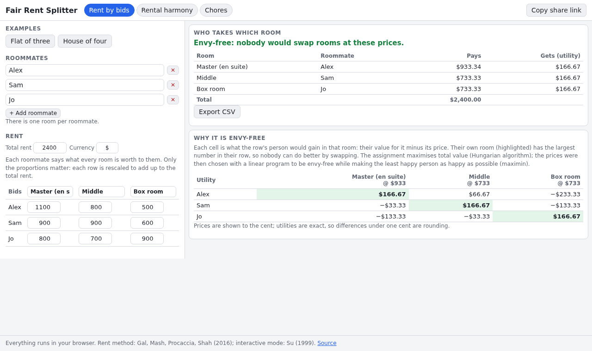

# Fair Rent Splitter

Split rent and chores so nobody envies anyone. Roommates bid what each room is worth to them, and the tool finds who should take which room and what each room should cost, so that nobody would swap with anybody else. It also has an interactive "rental harmony" mode that needs no bids, only answers to "which room would you take at these prices?", and a chore splitter that is fair up to one chore, with a weekly rotation you can export.

**Try it: [hermes98761234.github.io/fair-rent-splitter](https://hermes98761234.github.io/fair-rent-splitter/)**

[](https://github.com/hermes98761234/fair-rent-splitter/actions/workflows/deploy.yml)



## Features

- **Envy-free, max-welfare rent division** for 2 to 8 roommates. Prices always add up to the rent and may go negative when a room is a clear dud.
- **A table that shows why it is fair**: each person's utility (value minus price) for every room at the final prices. Their own room is the largest number in their row.
- **Rental harmony mode**: Su's Sperner's-lemma walk, asked one roommate at a time (up to 4 people). Undo, restart, or let it answer from the bids to see how it converges.
- **Chores with per-person time estimates**, divided by round-robin or envy-cycle elimination so the result is envy-free up to one chore (EF1), optionally trimmed to the least total time while staying EF1.
- **Weekly rotation schedule** (same bundles each week, or bundles passed along) with minutes per person per week.
- **Shareable link**: the whole state lives in the URL hash, so each roommate can open the same results. Nothing is sent to a server.
- **CSV export** for the rent result, the chore allocation and the schedule. Light and dark theme, works on a phone, inputs are remembered in the browser.

## How it works

**Rent by bids.** Each person's bids are rescaled to add up to the rent. The assignment that maximises total value is found with the Hungarian algorithm. With that assignment fixed, a linear program picks prices `p` with `sum p = rent`, no envy (`v[i][own] - p[own] >= v[i][j] - p[j]` for every room `j`) and the largest possible minimum utility `t`. This is the maximin envy-free solution of Gal, Mash, Procaccia and Shah. The LP is solved by a small two-phase simplex written for this project (`src/lib/lp.ts`).

**Rental harmony.** Price lists with `sum p = rent` and no room dearer than the rent form a simplex, cut into a fine triangulation (Freudenthal). Each lattice point is owned by one roommate, so every small simplex has one corner per person, and the answer there is the room that person would take (never a room costing the whole rent). That is a Sperner labelling, so a small simplex whose corners carry all different rooms must exist, and the tool finds it by following a path of "doors" from the boundary. The centroid of its corners is an approximately envy-free price list: each person's best room is within two grid steps of the assigned one. Reference: Francis Edward Su, "Rental Harmony: Sperner's Lemma in Fair Division", American Mathematical Monthly 106 (1999).

**Chores.** Costs are additive minutes per person. Round-robin lets people take turns picking the chore that is cheapest for them. Envy-cycle elimination hands each chore to someone who envies nobody and trades bundles along envy cycles (top trading). Both are EF1: after dropping one of their own chores, nobody prefers another bundle. See Bhaskar, Sricharan and Vaish (2021), "On approximate envy-freeness for indivisible chores and mixed resources". The optional improvement step hill-climbs over moves and swaps that lower total time while keeping EF1.

Tests check envy-freeness and price sums on random instances, the Hungarian algorithm against brute force, the simplex solver on known LPs (including a cycling example), Sperner paths on random labellings, and EF1 for chores.

Rent method: Gal, Mash, Procaccia, Shah, "Which is the fairest (rent division) of them all?", EC 2016 (journal version "Fair and Efficient Division of Rent").

## Quick start

You need [Node.js](https://nodejs.org/) 22.

```bash
git clone https://github.com/hermes98761234/fair-rent-splitter.git
cd fair-rent-splitter
npm install
npm run dev       # http://localhost:5173
npm test          # solver, Sperner, chores and state tests
npm run build     # static site in dist/
```

## License

MIT.
